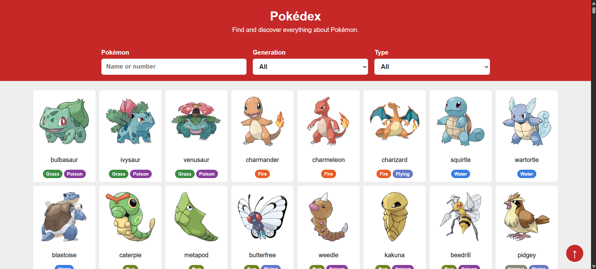

<h1 align="center">Second Assigment- Pokedex</h1>

<p align="center">
  Find your favorite Pokemons, and khow more about theme!
</p>

<p align="center">
  
</p>

<p align="center">
  
  
  
</p>

---

##  Description

- An interactive Pokédex where you can search for any Pokémon and view its type, stats, and image, with data loaded in real time from the PokéAPI.

## How to run it?
- Just open the index.html, but it requires the internet connection to access the API

## Features
- Search by name or number, updating as you type.
- Filters by generation (I to IX) and by type, which can be combined with the search.
- Cards featuring official imagery and their types.
- “Back to top” button, fixed navbar, smooth animations.
- Background music on a loop (volume 30%). In the right have mute button.

## What it was used?
- HTML,CSS;JAVASCRIPT
- Pokémon API
- Textfont: Press Start 2P

## Structure
- index.html, style.css, script.js, m.mp3

##  Some Functions
- **cardMatchesFilters(pokemon)**

```bash
function cardMatchesFilters(pokemon) {
  const query = searchInput.value.trim().toLowerCase();
  const id = getIdFromUrl(pokemon.url);

  const matchesQuery = !query || pokemon.name.includes(query) || id.includes(query);
  const matchesGeneration = !state.generationNames || state.generationNames.has(pokemon.name);
  const matchesType = !state.typeNames || state.typeNames.has(pokemon.name);

  return matchesQuery && matchesGeneration && matchesType;
}
```
- It combines the research, generation, and type into a single condition, and a Pokémon only appears if it meets all three simultaneously.

- **getPokemonTypes(id)**
```bash
async function getPokemonTypes(id) {
  if (!cache.pokemonTypes.has(id)) {
    if (!cache.pokemonTypeRequests.has(id)) {
      const request = getJson(`${api}/pokemon/${id}`)
        .then((pokemon) => {
          const types = pokemon.types.map((entry) => entry.type.name);
          cache.pokemonTypes.set(id, types);
          return types;
        })
        .finally(() => cache.pokemonTypeRequests.delete(id));

      cache.pokemonTypeRequests.set(id, request);
    }

    await cache.pokemonTypeRequests.get(id);
  }

  return cache.pokemonTypes.get(id);
}
```
- Loads the types for each Pokémon

- **showPokemonDetails(id)**
```bash
async function showPokemonDetails(id) {
  try {
    const [pokemon, species] = await Promise.all([
      getJson(`${api}/pokemon/${id}`),
      getJson(`${api}/pokemon-species/${id}`).catch((error) => {
        console.error(`Could not load Pokémon description for ${id}:`, error);
        return null;
      })
    ]);

    const info = document.getElementById("info");
    const statsMarkup = buildStatsMarkup(pokemon.stats);

    info.innerHTML = `
      <div class="pokemon-details">
        
        <section class="pokemon-info">
          <h2>${pokemon.name}</h2>
          <p class="pokemon-description"></p>
          <div class="pokemon-stats">${statsMarkup}</div>
          <button type="button" data-close-details>Close</button>
        </section>
      </div>`;

    info.querySelector(".pokemon-description").textContent = getDescription(species);
    info.showModal();
  } catch (error) {
    console.error("Could not load Pokémon details:", error);
    grid.textContent = "Could not load Pokémon details. Please try again.";
  }
}
```
- Show the details of the pokemon: image, name, status

##  Authors

- Duarte Baptista | 2023212845 | 2026/27 
